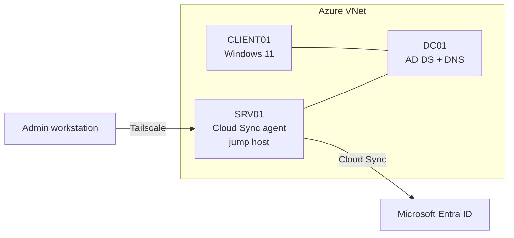

# Entra Identity Lab

A hands-on Microsoft Entra ID and hybrid Active Directory lab, built to deepen my identity and access expertise and to prepare for the **SC-300: Microsoft Identity and Access Administrator** exam.

Everything here was built and written from scratch in my own lab tenant and Azure subscription. No former-employer code or configuration is included.

---

## Environment

| Component | Details |
|---|---|
| Cloud | Microsoft Entra ID (lab tenant, Microsoft 365 E7 / Entra Suite) |
| Infrastructure | Azure: one VNet, three VMs, no public IPs |
| DC01 | Windows Server 2025, AD DS + DNS |
| SRV01 | Windows Server 2025, domain-joined. Cloud Sync provisioning agent, jump host |
| CLIENT01 | Windows 11 Enterprise, domain-joined. Used for device and client-side labs |
| Remote access | Tailscale to the jump host only (no inbound RDP from the internet) |
| Cost controls | Budget alert, auto-shutdown on every VM, deallocate after each session |



---

## Completed

- **Hybrid identity:** Entra Cloud Sync with a gMSA-based provisioning agent, OU-scoped sync, and password hash sync. Verified a synced user signing in to Entra.
- **Delegated administration:** administrative units with a scoped Helpdesk Administrator. Verified the admin could manage only users in that unit.
- **Identity lifecycle:** bulk user creation and dynamic membership groups with rule validation.
- **External identities:** B2B guest invitations and redemption reset (confirmed the guest kept the same object ID and group memberships).
- **Secure access foundations:** two emergency access accounts, Temporary Access Pass, and passkey authentication method policies.
- **Custom domain:** verified a public domain in Entra and added a matching UPN suffix in on-prem AD.

## In progress

- Cross-tenant access settings and cross-tenant synchronization
- Conditional Access (report-only first, then enforced) and ID Protection
- Global Secure Access (Private Access and Internet Access)
- Workload identities: managed identities, app registrations, Application Proxy
- Identity governance: PIM, access reviews, entitlement management
- Monitoring: sign-in logs to Log Analytics and KQL queries

---

## Key design decisions

| Decision | Why |
|---|---|
| Cloud Sync over Connect Sync | Lightweight agent with cloud-managed configuration, and Microsoft's direction for new sync features. Connect Sync is still the right choice for device objects, pass-through authentication, or complex attribute filtering. |
| Tailscale jump host instead of public RDP | Keeps every VM off the public internet at no cost. |
| No Tailscale on the domain controller | Avoids a multi-homed DC and the DNS registration problems that come with it. |
| Emergency access accounts first | Created before any Conditional Access work and excluded from every policy, so a bad policy can't lock out the tenant. |
| Cost guardrails before building VMs | Budget alert and auto-shutdown set up first, not after the first surprise bill. |

---

## Repo layout

```
labs/        One write-up per lab: goal, steps, verification, lessons learned
decisions/   Short decision records (what I chose, what I didn't, and why)
scripts/     Microsoft Graph PowerShell versions of the labs (sanitized)
```

## Ground rules

- Lab tenant and lab subscription only.
- No secrets, tenant IDs, keys, or passwords in this repo.
- No code or configuration from any current or former employer.
